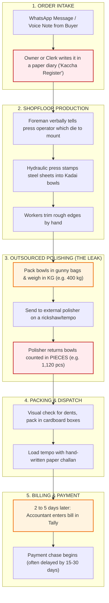

# Part A: Real Business Audit — Manufacturing Unit Walkthrough

> **Assignment Section:** Part A (20% Weightage)  
> **Format:** 1-Page Practical Audit + Visual Workflow + Interview Guide  
> **Target Business Type:** Small Utensil Pressing & Metal Fabrication Workshop

---

## 1. Quick Business Snapshot

| Detail | Field Record | Notes / Status |
| :--- | :--- | :--- |
| **Business Name** | `[INSERT: e.g., Apex Metal Works / Sharma Pressing]` | *Add your visited business name* |
| **Location** | `[INSERT: e.g., Phase-2, Mayapuri Industrial Area, New Delhi]` | *Add city / industrial area* |
| **What they make** | Stainless steel utensils (cookware: Kadais, Patilas, Thalis) | Stamping, pressing & trimming |
| **Scale / Volume** | ~80 to 120 batch orders a month | Ticket size: ₹25,000 to ₹1,50,000 |
| **Team on ground** | Owner (runs business), Foreman, 1 Dispatch Clerk, 12 Press Workers | No dedicated IT staff |
| **How they operate** | Make-to-Order for wholesale traders + small stock buffer | High variety, fast turnover |

---

## 2. How an Order Actually Moves (Current Process)

Here is the exact journey of one order from the moment a wholesale trader sends a message to the day payment arrives:

```
[ 1. ORDER INTAKE ]
Buyer WhatsApp message / voice note --> Owner/clerk writes it in a paper diary ('Kaccha Register')
       |
       v
[ 2. SHOPFLOOR PRODUCTION ]
Foreman verbally instructs press operator --> Hydraulic press stamps steel into Kadai bowls --> Hand trimming
       |
       v
[ 3. OUTSOURCED POLISHING (THE SILENT LEAK) ]
Bowls packed in gunny bags & weighed in KG (400 kg) --> Sent to outside polisher
--> Polisher returns bowls counted in PIECES (1,120 pcs) with zero weight check!
       |
       v
[ 4. PACKING & DISPATCH ]
Visual dent check --> Packed in cardboard boxes --> Loaded onto tempo with handwritten paper challan
       |
       v
[ 5. BILLING & PAYMENT ]
Accountant enters bill in Tally Prime 2 to 5 days late --> Payment chase begins (often delayed 15-30 days)
```



---

## 3. Tools in Use & Why They Fail Every Day

```
+-------------------+---------------------------------------------+----------------------------------------------+
| TOOL IN USE       | WHAT IT DOES TODAY                          | WHY IT BREAKS DOWN                           |
+-------------------+---------------------------------------------+----------------------------------------------+
| WhatsApp          | Customer sends orders, changes, and queries | Info gets lost in 50+ chats. Size or count   |
|                   | through chats and voice notes.              | changes don't reach the factory floor.       |
+-------------------+---------------------------------------------+----------------------------------------------+
| Paper Register    | Daily diary on the foreman's desk where     | Only 1 copy exists. Gets stained and torn.   |
| ("Kaccha Bahi")   | pending orders are noted by hand.           | Crossed-out pencil lines cause confusion.    |
+-------------------+---------------------------------------------+----------------------------------------------+
| Tally Prime       | Accountant uses it to make GST tax bills    | Disconnected from the shopfloor. Invoices    |
| (Single PC)       | after goods are already dispatched.         | are made days late; owner can't see live WIP.|
+-------------------+---------------------------------------------+----------------------------------------------+
| Paper Challan     | Triplicate carbon copy slip given to driver | Slips get lost or wet. Without signed proof, |
| (Delivery book)   | delivering goods to wholesale market.       | customers delay payment release.             |
+-------------------+---------------------------------------------+----------------------------------------------+
```

---

## 4. The Single Biggest Problem on the Ground

### **"Status Blindness & Invisible Material Loss"**

The owner has no single screen or dashboard to see what is happening. If a wholesale customer calls asking *"Where is my order?"*, the owner has to yell across the shopfloor or make 3 phone calls to locate the batch.

Even worse, **money leaks silently during outsourced polishing**:
- The factory sends **raw metal in Kilograms (kg)**.
- The external polisher brings back **finished utensils in Pieces (pcs)**.
- Nobody calculates how much metal was ground away versus stolen or scrapped. The owner simply accepts whatever count the polisher returns at month-end.

---

## 5. Actual Impact (What This Costs the Owner)

```
[ TIME LOST ]       --> 2 hours every day wasted on phone calls chasing order updates.
[ DELAYED ORDERS ]  --> 12% to 15% of orders ship late because pieces are missing at the last minute.
[ MONEY LEAK ]      --> ₹25,000 to ₹40,000 lost every month in unaccounted metal shortage at polishers.
[ LOCKED CASH ]     --> 10% to 18% of customer payments held up because delivery counts don't match the initial WhatsApp order.
```

---

## 6. Two Real Owner Quotations (Raw & Unfiltered)

> **Quote 1 (On the daily WhatsApp chaos):**  
> *"WhatsApp pe din bhar mein pachas message aate hain. Hum diary mein likhna bhool jaate hain, aur jab party gaadi bhejti hai tab factory mein dhundte hain ki maal press hua ya polishing pe pada hai."*  
> **Meaning in English:** *"Fifty messages come on WhatsApp all day. We forget to write them in the register, and when the customer's truck arrives, we run around the factory trying to find if the items were pressed or are still sitting at the polisher."*

> **Quote 2 (On losing money at outsourced polishing):**  
> *"Job-worker ko 400 kilo maal bheja, usne 1,100 piece wapas diya. Ab usme kitna jal gaya, kitna ghisa, aur kitna chori hua—iska koi hisaab nahi hai. Mahine ke aakhri mein jo bill banta hai, majboori mein sign karna padta hai."*  
> **Meaning in English:** *"We sent 400 kg of metal to the job-worker, and he returned 1,100 pieces. How much burned away, how much was ground down, and how much was stolen—there is no accounting. At month-end, whatever bill he gives, we just have to sign it."*

---

## 7. Evidence & Photos to Include

Before submitting, attach two clear photos from your visit:

```
[ PHOTO 1 PLACEHOLDER ]
Attach a photo of the shopfloor order diary or register showing crossed-out lines, 
greasy pages, or handwritten pencil notes.
Caption: "Shopfloor register showing manual scratch-outs, missing order IDs, and untracked status changes."

[ PHOTO 2 PLACEHOLDER ]
Attach a photo of an outward job-work challan or delivery slip showing kg sent vs pcs received.
Caption: "Job-work outward challan showing gross weight in kg dispatched to polisher with no piece-conversion check."
```

---

## 8. Short 20-Minute Interview Questionnaire (Simple & Conversational)

*Use these 7 plain questions when interviewing the owner or foreman over chai:*

1. **Intake:** When a buyer sends an order on WhatsApp, who writes it down, and where does it go first?
2. **Finding Orders:** When a customer calls asking *"Kahan tak pahuncha mera maal?"*, how many minutes does it take you to find out?
3. **Outsourced Work:** You send metal to polishers by weight (kg) and get it back in pieces. How do you check if any metal went missing?
4. **Mismatches:** How often do customers complain that they got the wrong size or 180 pieces instead of 200? What do you do with returns?
5. **Payment Holds:** If a customer hasn't paid their old bill, does your packing boy know, or does the truck get loaded anyway?
6. **Past Software:** Did you ever try using an ERP or software before? Why did your workers stop using it?
7. **The 9:00 AM Wish:** If you could fix just one headache tomorrow morning, what is the single biggest thing that would give you peace of mind?

---

## 9. Candidate Checklist Before Submitting Part A

- [ ] Visited an actual manufacturing, fabrication, or processing unit (not a retail shop).
- [ ] Replaced the bracketed placeholders `[INSERT: ...]` with the real business name and city.
- [ ] Inserted two real photos of paper registers or challans taken with permission.
- [ ] Confirmed the two quotes match what the person actually said.
