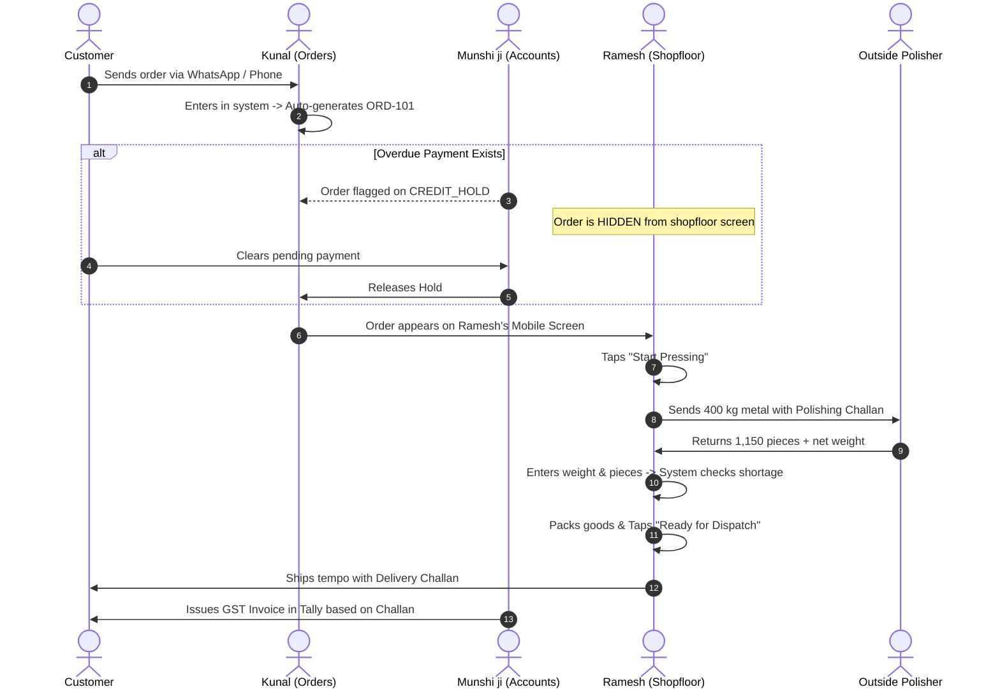

# Business Requirements Document (BRD)
## Project: Vardhan Steelware — Shopfloor & Order Tracking System (Phase 1)

> **Document Summary:** 4-Page Practical Requirements Document  
> **Prepared for:** Suresh (Owner, Vardhan Steelware)  
> **Key People:** Kunal (Orders), Ramesh (Shopfloor/Dispatch), Munshi ji (Accounts)  
> **Goal:** Stop order loss, eliminate duplicate production, and track outsourced polishing leakage.

---

## 1. The Real Story: What’s Going Wrong at Vardhan Steelware

Vardhan Steelware makes stainless steel utensils (Kadais, cookware). They press steel bowls in-house, send them outside for polishing, and ship them to wholesale buyers.

The business is running, but nobody has a single source of truth. Information is scattered across WhatsApp messages, unlinked Excel sheets, paper diaries, and Tally:

```
[ KUNAL: Orders ]        --> Keeps orders in WhatsApp & a spreadsheet.
[ RAMESH: Shopfloor ]    --> Runs heavy presses based on verbal instructions & a diary.
[ MUNSHI JI: Accounts ]  --> Sits in the office on Tally; only finds out what shipped days later.
[ OUTSIDE POLISHER ]     --> Gets metal by weight (kg); returns finished bowls by piece count (pcs).
[ SURESH: Owner ]        --> Spends 2 hours every morning calling everyone just to know what is happening.
```

### The 4 Costly Consequences:
1. **Blindness:** Suresh can't tell a buyer if their order is ready without making 3 phone calls across the factory.
2. **Double Work:** The same order gets written twice in the sheet, risking making 200 extra Kadais that nobody paid for.
3. **Outsourced Leakage:** 420 kg of steel goes to the polisher; 1,180 pieces come back with 6 kg missing. Nobody knows if it was burned, ground away, or stolen.
4. **Credit Slip-Through:** Ramesh presses and packs an order for a client who hasn't cleared their old bills, because Munshi ji's payment hold never reached the shopfloor.

---

## 2. Real Evidence: The 7 Data Problems Found in Vardhan's Records

When we audited Vardhan's tracking sheets and WhatsApp records, we found 7 clear problems. Here is the breakdown in plain language:

| Ref | What We Found in the Records | Why It Hurts the Business | How We Fix It in Phase 1 | Status |
| :---: | :--- | :--- | :--- | :--- |
| **1** | **Gupta Traders Duplicate**<br>200-pc Kadai appears twice: once marked 'Dispatched', once 'Pending'. | Factory risks pressing another 200 pieces by mistake, locking cash in unsold stock. | System gives every order a unique number (`ORD-101`). If Kunal types the same customer and item within 48 hours, a warning pops up. | *Check delivery challan to confirm* |
| **2** | **Jain Crockery Repeat**<br>150-pc Kadhai order line is entered two times. | Creates false demand; Ramesh wastes die-setting time for an order that isn't real. | System alerts if an identical line item is added to the same order on the same date. | *Verify if re-order or accidental copy* |
| **3** | **Order with No Customer Name**<br>A row shows sizes and pieces, but client name is blank. | Goods get manufactured but sit on the loading dock because nobody knows where to ship them. | Mandatory field: System will not let Kunal save an order without selecting an active customer. | **Confirmed Data Error** |
| **4** | **Quantity in KG without Rate**<br>A pending order has quantity written in 'kg' with rate left blank. | Utensils are sold in pieces, not kg. Without a rate, Munshi ji cannot bill the client accurately. | System enforces 'Pieces' as the unit for finished goods and auto-fills rates from an approved price list. | **Confirmed Data Error** |
| **5** | **Sharma's Order on Hold**<br>Marked 'Hold' for old payment dues, but visible in the production list. | Ramesh will press and load the goods. Once the tempo leaves, collecting old debt is impossible. | **Hold Gate:** Any order on `CREDIT_HOLD` is completely hidden from Ramesh's mobile screen until Munshi ji unlocks it. | **Confirmed Operational Risk** |
| **6** | **Negative Quantity Row**<br>A negative number appears in the sales sheet for returned goods. | Messes up total sales numbers and doesn't explain why goods came back (dent, polishing flaw, or wrong size). | Dedicated **Return Screen**: Records returned pieces, the reason, and whether they need repolishing or scrap. | **Confirmed Process Gap** |
| **7** | **Polishing Discrepancy**<br>Sent 420 kg of metal; received 1,180 pieces; 6 kg shortage noted. | Huge margin leak. Without tracking weight vs piece count, Vardhan loses ₹30,000+ monthly in unaccounted metal. | **Dual-Unit Reconciliation:** System calculates weight sent vs pieces returned and flags any shortage over 1.5%. | **Confirmed Margin Leak** |

---

## 3. How Work Should Flow (Who Does What)

Here is the clean, visual hand-off between team members:



---

## 4. Phase 1 Boundaries: What We Build vs What We Delay

Vardhan previously bought an ERP that completely failed because it was too complicated. To guarantee 100% adoption this time, we draw strict boundaries:

```
+-------------------------------------------------+----------------------------------------------------+
| IN PHASE 1 (Keep It Simple & Usable)            | NOT IN PHASE 1 (Avoid Software Bloat)              |
+-------------------------------------------------+----------------------------------------------------+
| 1. Central Order Register with unique ORD-IDs.  | 1. No AI sales forecasting (data isn't ready yet). |
| 2. Mobile 3-tap status buttons for Ramesh.      | 2. No replacing Tally (Munshi ji keeps his Tally). |
| 3. Credit Hold gate (blocks unapproved orders). | 3. No contractor logins (polishers don't use apps).|
| 4. Outsourced polishing weight vs piece tracker.| 4. No barcode scanners or machine sensors.         |
| 5. Partial dispatch tracking (split shipments). | 5. No complex multi-layer approval hierarchies.    |
| 6. Three 8:30 AM daily morning summary reports. |                                                    |
+-------------------------------------------------+----------------------------------------------------+
```

---

## 5. Functional Requirements (What the System Must Do)

### [FR-01] Easy Order Entry & Unique ID
- **What it does:** Kunal enters customer name, SKU (e.g. Kadai 22), pieces, rate, and delivery date. The system assigns a unique number like `ORD-2026-0042`.
- **Primary User:** Kunal (Order Coordinator).
- **Why it matters:** Stops handwritten slips from getting lost and prevents duplicate orders.
- **How to test:** Try saving without a customer name — system should block it. Try entering the same item for the same customer twice — system should show a warning dialog.
- **Priority:** Must Have.

### [FR-02] Automatic Credit Hold Gate
- **What it does:** If Munshi ji marks a customer as overdue, any new order automatically gets tagged `CREDIT_HOLD`.
- **Primary User:** Munshi ji (Accounts) & Suresh (Owner).
- **Why it matters:** Protects working capital by stopping factory workers from pressing metal for defaulting clients.
- **How to test:** Put "Sharma" on hold. Check Ramesh’s screen — Sharma's order must not appear on his active job list.
- **Priority:** Must Have.

### [FR-03] Outsourced Polishing Dual-Unit Tracker
- **What it does:** When sending metal to the polisher, Ramesh enters gross weight (kg). When the batch returns, he enters received weight (kg) and finished pieces (pcs).
- **Primary User:** Ramesh (Production) & Kunal.
- **Why it matters:** Fixes the 6 kg shortage problem by calculating:  
  `Shortage = Dispatched Weight - (Returned Weight + Scrap)`.
- **How to test:** Enter 420 kg sent and 410 kg returned with 1,180 pieces. If shortage is >1.5%, an orange "High Shortage Alert" must appear for Suresh.
- **Priority:** Must Have.

### [FR-04] Ramesh’s 3-Tap Mobile Screen (Zero Typing)
- **What it does:** A super-simple mobile screen designed for the noisy factory floor. Ramesh never types words; he just taps 3 big color-coded buttons:

```
+----------------------------------------------------------------+
|  RAMESH'S MOBILE SHOPFLOOR VIEW                                |
|                                                                |
|  Order: ORD-101 (Gupta Traders) - 200 pcs Kadai 24             |
|  Status: Waiting to Start                                      |
|                                                                |
|  [ TAP 1: START PRESSING ]  -->  (Turns Blue: In Pressing)     |
|  [ TAP 2: SENT TO POLISH ]  -->  (Turns Yellow: At Polisher)   |
|  [ TAP 3: READY TO SHIP  ]  -->  (Turns Green: In Packing)     |
+----------------------------------------------------------------+
```

- **Primary User:** Ramesh (Shopfloor / Dispatch).
- **Why it matters:** Factory workers don't use keyboards. If it isn't as fast as WhatsApp, they will abandon it.
- **How to test:** Hand Ramesh a low-cost Android phone. He should update an order's stage in under 10 seconds without asking for help.
- **Priority:** Must Have.

### [FR-05] Partial Dispatch Tracking (Split Deliveries)
- **What it does:** If a customer orders 200 pieces, but only 120 fit on today’s tempo, the system ships 120 pieces on `Challan-01` and keeps the remaining 80 pieces in the pending queue.
- **Primary User:** Ramesh & Kunal.
- **Why it matters:** Stops orders from disappearing from the pending list after a partial shipment.
- **Priority:** Must Have.

### [FR-06] Clear Returns Screen (No Negative Numbers)
- **What it does:** A dedicated return screen where Kunal logs returned pieces, client name, and reason (Dents, Polishing Scratches, Wrong Size).
- **Primary User:** Kunal & Munshi ji.
- **Why it matters:** Replaces messy negative spreadsheet rows with clean credit note requests for Munshi ji.
- **Priority:** Should Have.

### [FR-07] Three 8:30 AM Morning Reports
- **What it does:** Automatically prepares three clear summaries on Suresh’s and Ramesh’s phones every morning.
- **Primary User:** Suresh (Owner).
- **Priority:** Must Have.

---

## 6. Non-Functional Rules (Speed & Reliability)

- **Mobile First (NFR-01):** Big touch targets (at least 16px font), readable in bright sunlight, works on cheap 5.5-inch Android phones.
- **Speed (NFR-02):** Searching any order by customer or number takes less than 1 second, even on a 3G/4G network.
- **Role Security (NFR-03):** Ramesh can see quantities and sizes, but **customer prices and profit margins are hidden** from the shopfloor screen.
- **Offline Tolerance (NFR-04):** If the factory Wi-Fi drops, Ramesh can still tap buttons. The phone saves the update and syncs as soon as connection returns.

---

## 7. Simple Data Structure (How the Pieces Connect)

Here is how the system connects orders, polishing batches, and dispatches:

```
[ CUSTOMER ] 
     |  (1 customer has many orders)
     v
 [ ORDER ]  -----> Holds: Order ID, Date, Status, Hold Flag
     |
     |  (1 order has many items)
     v
 [ ORDER ITEM ]  -----> Holds: SKU (Kadai 22), Pieces Ordered, Rate
    /          \
   /            \
  v              v
[ POLISHING BATCH ]        [ DISPATCH ITEM ]
- Batch ID                 - Challan Number
- Weight Sent (kg)         - Quantity Shipped (e.g. 120 pcs)
- Weight Received (kg)     - Date & Vehicle Number
- Pieces Received (pcs)    
- Shortage (kg)            
```

*Note on Accounts:* In Phase 1, we do NOT touch Tally Prime. Munshi ji generates tax invoices in Tally using the delivery challans printed from this system.

---

## 8. Who Gets Access to What (Role Matrix)

```
+----------------------------+-----------+-----------+------------+-------------+
| FEATURE                    | SURESH    | KUNAL     | RAMESH     | MUNSHI JI   |
|                            | (Owner)   | (Orders)  | (Floor)    | (Accounts)  |
+----------------------------+-----------+-----------+------------+-------------+
| Create & Edit Orders       | FULL      | FULL      | NO         | VIEW ONLY   |
| Place / Release Holds      | FULL      | NO        | NO         | FULL        |
| 3-Tap Shopfloor Updates    | FULL      | VIEW ONLY | FULL (App) | NO          |
| Enter Polishing kg & pcs   | FULL      | FULL      | FULL       | VIEW ONLY   |
| View Rates & Profits       | FULL      | VIEW ONLY | HIDDEN     | FULL        |
| Create Delivery Challans   | FULL      | FULL      | FULL       | VIEW ONLY   |
| Daily Morning Reports      | FULL      | OPS VIEW  | FLOOR VIEW | BILLS VIEW  |
+----------------------------+-----------+-----------+------------+-------------+
*Note: Outside polishing contractors do NOT get system logins. Their records are entered internally by Ramesh.*
```

---

## 9. The Three Morning Reports Suresh Needs at 8:30 AM

```
+----------------------------------------------------------------------------------------------------+
| REPORT 1: PENDING ORDERS BY STAGE & DAYS DELAYED                                                   |
| • Purpose: Shows Suresh and Ramesh exactly which orders are stuck in pressing, polishing, or pack. |
| • Key Columns: Order ID | Customer | SKU | Pcs Pending | Current Stage | Days Delayed (>3d = Red)  |
+----------------------------------------------------------------------------------------------------+
| REPORT 2: ORDERS ON HOLD (BLOCKED QUEUE)                                                           |
| • Purpose: Shows Munshi ji and Suresh which orders are paused so machine time is not wasted.       |
| • Key Columns: Order ID | Customer | Total Value (₹) | Reason (Credit Overdue / Rate Missing)     |
+----------------------------------------------------------------------------------------------------+
| REPORT 3: OUTSOURCED POLISHING SHORTAGE REPORT                                                     |
| • Purpose: Shows Suresh how much metal was sent, received, and lost in the last 24 hours.          |
| • Key Columns: Batch ID | Polisher Name | Sent (kg) | Returned (kg) | Returned (pcs) | Shortage %  |
+----------------------------------------------------------------------------------------------------+
```

---

## 10. How We Prevent Another Failed Software Rollout

Vardhan’s last software failed because staff stopped using it. Here is our 3-step adoption plan:

1. **Zero Shopfloor Typing:** Ramesh does not type text on a keyboard. He only taps big colored status cards on his phone.
2. **10-Day Kadai-Only Pilot:** We don't change everything at once. We run the system on just standard Kadai sizes (sizes 20–24) for 10 days until Ramesh and Kunal are comfortable.
3. **No Dual Work:** On Day 3 of the pilot, we retire the WhatsApp dispatch group for Kadais. Having one clear way to work forces adoption.

---

## 11. High-Value Questions for the Next Meeting with Suresh

1. *Suresh ji, who makes the final decision on this project, and does Munshi ji or Ramesh have the power to say no if they find it hard?*
2. *In the previous software that failed, what exact screen made your workers give up? Was it too many text boxes, or having to use a desktop PC?*
3. *When 420 kg goes to the polisher and comes back as 1,180 pieces with 6 kg missing, does the polisher return the metal scrap, or is that loss paid by you?*
4. *If a customer on payment hold offers 30% cash advance, can Kunal start production, or must Munshi ji sign off first?*
5. *Does Munshi ji make a Tally bill for every tempo dispatch, or one single bill at the end of the month?*
6. *When customers return damaged goods, do you repair them in-house, send them back to the polisher, or scrap them?*
7. *How often do buyers change their order after pressing has already started, and how do you notify the press worker right now?*
8. *If this system works perfectly for 30 days, what is the single biggest result that will make you say, 'This was worth every rupee'?*

---

## 12. Requirements Traceability: From Problem to Solution

```
+-----------------------------------+------------------------------------+-----------------------------------+
| EVIDENCE / PROBLEM FOUND          | PROPOSED REQUIREMENT               | HOW SUCCESS IS VERIFIED           |
+-----------------------------------+------------------------------------+-----------------------------------+
| Gupta & Jain duplicate orders     | FR-01: Unique Order IDs & Warning  | System alerts user when duplicate |
|                                   | on repeated customer items.        | customer + SKU entered in 48 hrs. |
+-----------------------------------+------------------------------------+-----------------------------------+
| Sharma credit hold bypassed       | FR-02: Credit Hold Gate            | Orders on hold are invisible to   |
|                                   |                                    | shopfloor mobile view.            |
+-----------------------------------+------------------------------------+-----------------------------------+
| 6 kg shortage in polishing batch  | FR-03: Dual-Unit Weight/Pcs Tracker| Discrepancy > 1.5% flags red      |
|                                   |                                    | warning for Suresh.               |
+-----------------------------------+------------------------------------+-----------------------------------+
| Staff resisted previous ERP       | FR-04: 3-Tap Mobile Status screen  | Ramesh updates batch status in    |
|                                   |                                    | under 10 seconds without typing.  |
+-----------------------------------+------------------------------------+-----------------------------------+
| Partial truck shipments lost      | FR-05: Partial Dispatch Balance    | Live balance tracked:             |
|                                   |                                    | Remaining = Ordered - Shipped.    |
+-----------------------------------+------------------------------------+-----------------------------------+
| Negative number sales return rows | FR-06: Dedicated Return Screen     | Return reason logged; generates   |
|                                   |                                    | credit note task for Munshi ji.   |
+-----------------------------------+------------------------------------+-----------------------------------+
```
